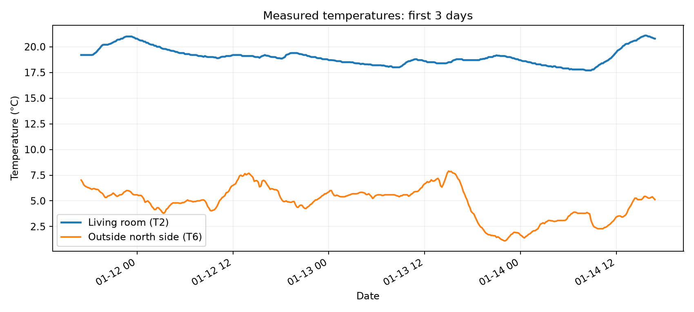
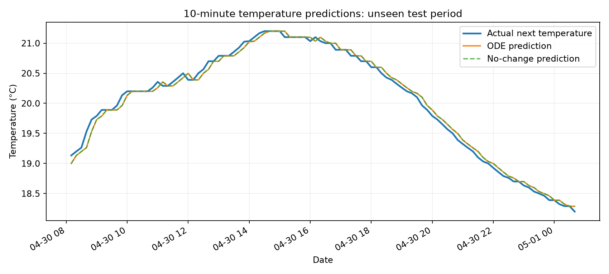
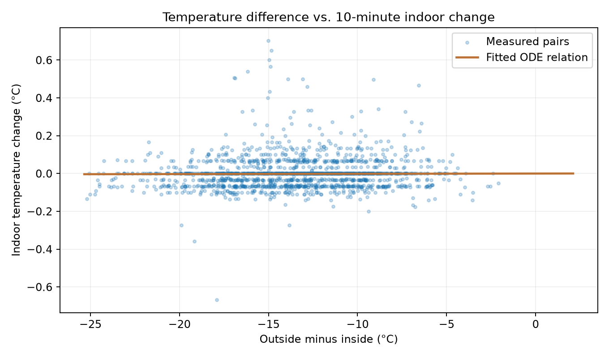

# Living Room Temperature Prediction Using Newton's Law of Cooling

## Research Question

Can Newton's Law of Cooling predict living room temperature changes over a 10-minute interval using outdoor temperature measurements?

## Project Overview

The project aims to investigate whether a first-order differential equation ODE can be used to predict short-term indoor temperature changes using real building sensor measurements.

## Connection to my Advanced Mathematics lessons

The project is based on Chapter 3 and related WPO practice math that we learned.

The mathematical model is based on "Newton's Law of Cooling" which is:

**dT/dt = k(T_outside - T_inside)**

Where:

- T_inside is the indoor temperature.
- T_outside is the outdoor temperature.
- k is the temperature adjustment coefficient.
- t represents time.

## Planned Dataset

The project will use the **UCI Appliances Energy Prediction Dataset**, containing measurements from a residential building in Belgium.

Dataset source: https://archive.ics.uci.edu/dataset/374/appliances%2Benergy%2Bprediction

The analysis will focus on only:

- `date` — Measurement date and time
- `T2` — Living room temperature
- `T6` — Outdoor temperature on the north side of the building

## Project Plan

The following work is planned:

1. Obtain and examine the temperature dataset.
2. Analyze the relationship between indoor–outdoor temperature differences and indoor temperature changes.
3. Apply Newton's Law of Cooling to predict short-term indoor temperature.
4. Evaluate the predictions against actual measurements.
5. Create at least two Python visualizations.
6. Interpret the results and limitations.
7. Publish the findings on an HTML website.

## Dataset

For this project, I am using the **Appliances Energy Prediction Dataset** from the UCI Machine Learning Repository.

Dataset source: https://archive.ics.uci.edu/dataset/374/appliances%2Benergy%2Bprediction

The dataset contains 19,735 observations collected from a residential building in Belgium between January and May 2016. Measurements were recorded at 10-minute intervals.

Although the original dataset contains temperature, humidity, and energy consumption measurements, this project focuses on three variables:

| Variable | Description |
|---|---|
| `date` | Date and time of the measurement |
| `T2` | Living room temperature (°C) |
| `T6` | Outside temperature on the north side of the building (°C) |

### Data Preparation

I downloaded the original dataset using `download_data.py` and examined the selected variables in Python.

The steps included:

1. Loading the CSV file using pandas.
2. Selecting the `date`, `T2`, and `T6` columns.
3. Checking the number of observations.
4. Examining the first few measurements and basic temperature statistics.
5. Checking the selected columns for missing values.

The dataset is saved locally as `data/energydata_complete.csv`.

The repository contains the download script and data source instructions so that the original measurements can be obtained again.

## Mathematical Analysis Using Python

I performed two analyses using Python to investigate whether Newton's Law of Cooling can predict short-term changes in living room temperature.

The dataset contains 19,735 observations collected between 11 January and 27 May 2016. I used 15,787 consecutive temperature pairs for training and 3,947 pairs for testing.

### Analysis 1: Temperature Difference and Temperature Change

In the first analysis, I examined the relationship between the indoor–outdoor temperature difference and the actual change in living room temperature over a 10-minute interval.

I calculated:

1. The difference between outdoor and indoor temperature.
2. The observed change in living room temperature between consecutive measurements.
3. The temperature adjustment coefficient using the mathematical model.

Newton's Law of Cooling is expressed as:

**dT/dt = k(T_outside - T_inside)**

Where:
- **T** is the indoor temperature.
- **T_outside** is the outdoor temperature.
- **k** is the temperature adjustment coefficient.
- **t** represents time.

The estimated coefficient was:

**k = 0.00082944 per hour**

The correlation between temperature difference and observed temperature change was:

**Correlation = 0.05044**

This indicates a very weak positive relationship between the variables. It suggests that the outdoor temperature difference alone does not explain much of the short-term variation in living room temperature.

### Analysis 2: Predicting Living Room Temperature

In the second analysis, I used Newton's Law of Cooling to predict the living room temperature 10 minutes later.

I applied Euler's approximation:

**T_next = T_now + k × (1/6) × (T_outside - T_now)**

The factor **1/6** represents 10 minutes expressed in hours.

I estimated the model coefficient using the first 80% of consecutive observations and evaluated the predictions using the remaining 20%.

I compared the predicted temperatures with the actual measurements using Mean Absolute Error (MAE).

I also compared the mathematical model with a simple baseline model, which assumes that the living room temperature remains unchanged during the next 10 minutes.

The results were:

| Prediction Method | Mean Absolute Error (°C) |
|---|---|
| Newton's Law of Cooling model | 0.073627 |
| No-change baseline model | 0.073689 |

The Newton's Law model produced a slightly lower prediction error than the baseline model.

However, the improvement was approximately **0.085%**, which is very small. Therefore, the model did not provide a substantial improvement in prediction accuracy.

## Visualizations

I generated three graphs using Python and Matplotlib to present the findings from my analyses.

All three visualizations are available as both PNG and PDF files in the `figures` folder.

### Figure 1: Measured Indoor and Outdoor Temperatures

This graph shows how the living room temperature and the outdoor temperature changed during the first three days of recorded measurements.

[View Figure 1 as PDF](figures/01_measured_temperatures.pdf)

### Figure 2: Actual vs. Predicted Indoor Temperature

This graph compares the measured living room temperatures with the predictions from Newton's Law of Cooling and the no-change baseline.

[View Figure 2 as PDF](figures/02_actual_vs_predicted.pdf)

### Figure 3: Temperature Difference vs. Temperature Change

This graph illustrates the relationship between the indoor–outdoor temperature difference and the observed change in living room temperature over 10 minutes. It also shows the fitted mathematical relationship.

[View Figure 3 as PDF](figures/03_temperature_change_relation.pdf)

## Preliminary Findings

The analyses indicate that the relationship between outdoor–indoor temperature difference and short-term living room temperature change is very weak.

Although Newton's Law of Cooling produced slightly more accurate predictions than the no-change baseline, the improvement was extremely small.

This suggests that factors other than outdoor temperature may also influence indoor temperature changes.

